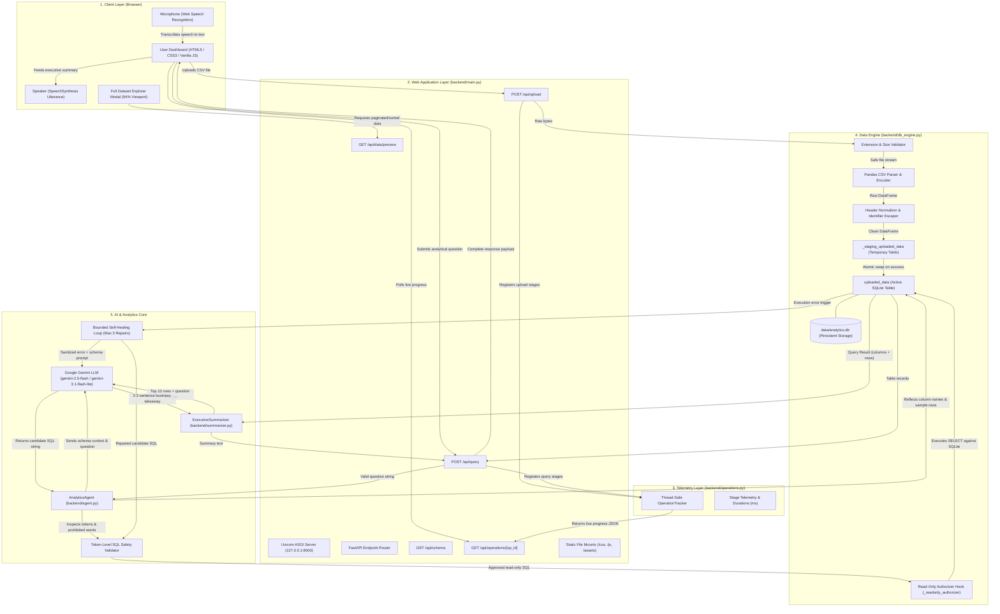
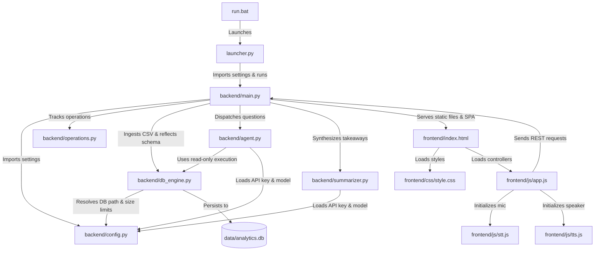
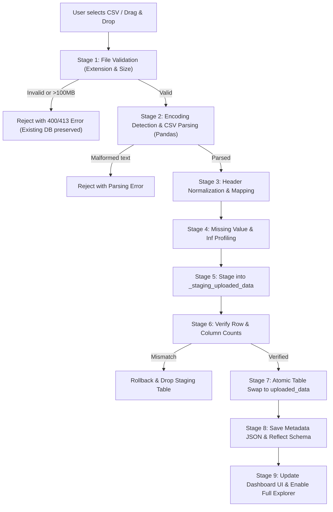
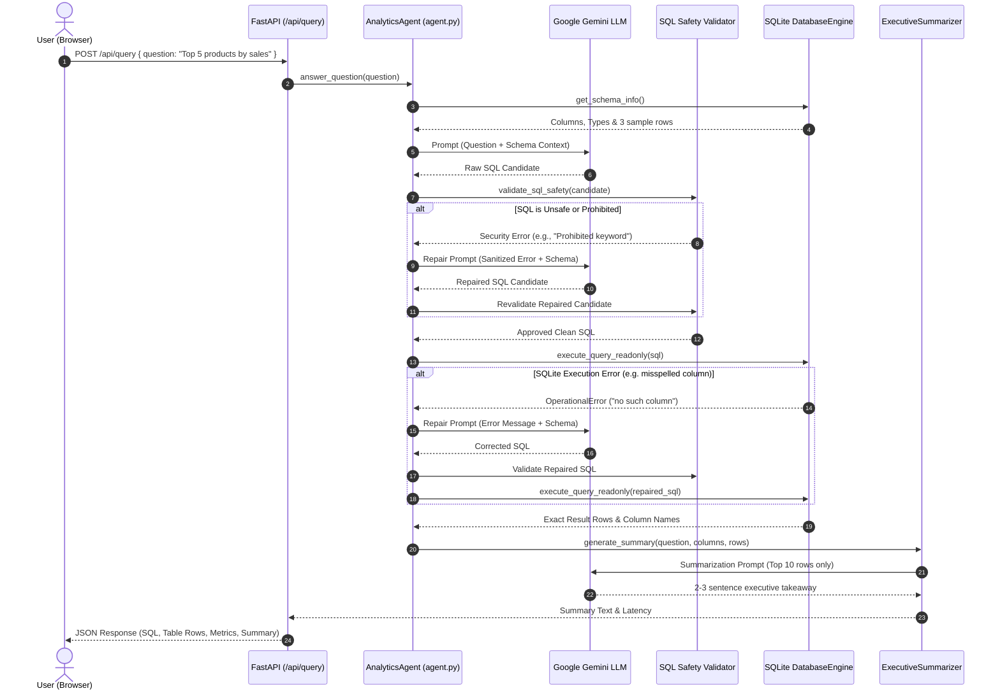
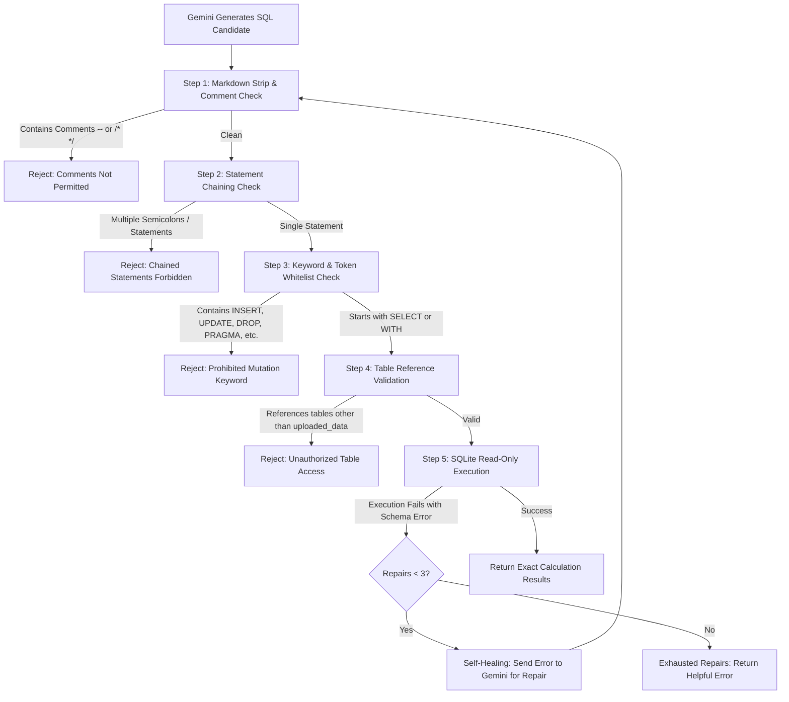
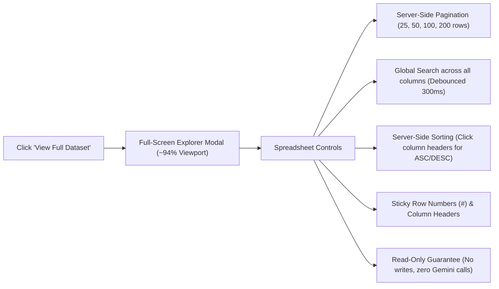
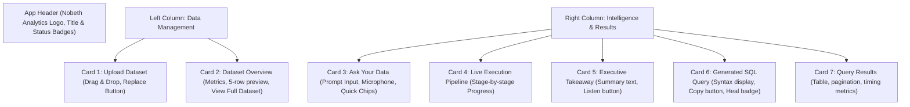
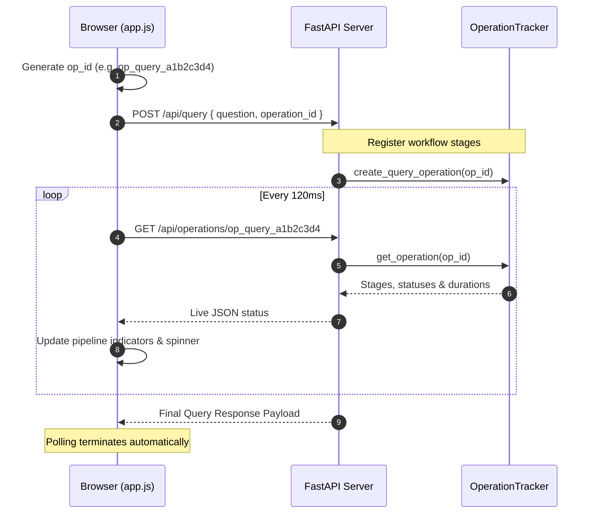

# VoiceCSV Analytics Agent

An enterprise-grade, local, voice-guided AI analytics web application built with **FastAPI**, **SQLite**, and **Google Gemini** (`google-genai` SDK).

VoiceCSV Analytics Agent allows business stakeholders and analysts to upload CSV files, explore schemas, ask analytical questions by typing or speaking through a microphone, receive safe SQLite queries, inspect execution metrics, and listen to AI-synthesized executive takeaways—without installing or managing separate frontend or database servers.

---

## Table of Contents

1. [Key Capabilities](#key-capabilities)
2. [Architecture & Data Flow](#architecture--data-flow)
3. [Technology Stack](#technology-stack)
4. [Project Directory Layout](#project-directory-layout)
5. [Prerequisites](#prerequisites)
6. [Quick Start (Windows One-Click Launcher)](#quick-start-windows-one-click-launcher)
7. [Manual Installation & Setup](#manual-installation--setup)
8. [Configuration & Google AI Studio API Key](#configuration--google-ai-studio-api-key)
9. [Using the Application](#using-the-application)
   - [CSV Ingestion & Schema Exploration](#csv-ingestion--schema-exploration)
   - [Natural Language & Voice Questions (STT)](#natural-language--voice-questions-stt)
   - [Executive Summary Audio Playback (TTS)](#executive-summary-audio-playback-tts)
   - [SQL Security & Self-Healing](#sql-security--self-healing)
10. [Running the Test Suite](#running-the-test-suite)
11. [Troubleshooting & FAQs](#troubleshooting--faqs)
12. [Security & Privacy Details](#security--privacy-details)
13. [Limitations & Browser Compatibility](#limitations--browser-compatibility)

---

## 1. Key Capabilities

- **Zero-Infrastructure Single-Server Deployment:** Single FastAPI application serving the REST API and the responsive single-page dashboard directly on `http://127.0.0.1:8000`.
- **Atomic CSV Ingestion:** Automatic header cleaning, SQLite-compatible column normalization, deduplication, and staging-table replacement ensuring the previous active dataset is never corrupted or dropped if a new upload fails.
- **Voice-Guided Natural Language Queries:** Speak questions naturally using browser-native Speech-to-Text (STT) or type questions in the prompt bar.
- **Multi-Layered SQL Security:**
  - Token-level candidate query validation blocking SQL comments, chained statements, mutations (`INSERT`, `UPDATE`, `DELETE`, `DROP`, `ALTER`, etc.), and system catalog leakage.
  - Native SQLite URI read-only connection mode (`mode=ro`) with `PRAGMA query_only = ON`.
  - SQLite Authorizer callback actively denying writes and locking query execution strictly to `uploaded_data`.
  - Execution timeout enforcement via progress handlers.
  - Automatic row capping to prevent browser lockup.
- **Automatic SQL Self-Healing:** Up to 3 bounded repair attempts where Gemini inspects sanitized execution errors alongside schema context to self-correct column or function mistakes.
- **Executive Business Summaries:** Grounded 2-3 sentence executive takeaways synthesized from actual query results.
- **Speech Synthesis Audio (TTS):** Browser-native audio playback reading executive summaries aloud with instant stop/pause controls.
- **Persistent Local Database:** Active datasets survive server restarts in `data/analytics.db`.

---

## 2. Architecture & Data Flow

```text
[ User / Browser ]
      │
      ├─► 1. Upload CSV (multipart/form-data) ──► FastAPI (/api/upload)
      │                                                │
      │                                                ▼
      │                                       Pandas CSV Normalization
      │                                                │
      │                                                ▼
      │                                     SQLite Staging Table Swap
      │                                    (data/analytics.db: uploaded_data)
      │                                                │
      ├─► 2. Schema Discovery (/api/schema) ◄──────────┘
      │
      ├─► 3. Ask Question (Voice / Text) ───────► FastAPI (/api/query)
      │                                                │
      │                                                ▼
      │                                        Gemini API (google-genai)
      │                                       Generates SQLite SELECT
      │                                                │
      │                                                ▼
      │                                     SQL Safety Validator
      │                                                │
      │                                                ▼
      │                                     SQLite Read-Only Engine
      │                                     (Authorizer + Query Timeout)
      │                                                │
      │                                      [If execution error]
      │                                                ├─► Gemini Self-Healing (Max 3)
      │                                                │
      │                                                ▼
      │                                     Executive Summarizer (Gemini)
      │                                                │
      │                                                ▼
      ├─◄ 4. Result Table, Summary & Audio ◄───────────┘
```

---

## 3. Technology Stack

| Component | Technology | Rationale |
| :--- | :--- | :--- |
| **Backend API** | FastAPI 0.110+ | High-performance, asynchronous REST framework with built-in Pydantic validation and static file mounting. |
| **Server** | Uvicorn 0.28+ | Lightweight ASGI production-ready server. |
| **Database** | SQLite 3 (Python built-in) | Embedded, zero-configuration, robust local database with native URI read-only mode and authorizer callbacks. |
| **Data Ingestion** | Pandas 2.2+ | High-throughput parsing, chunked database loading, and type inference. |
| **AI / LLM** | Google GenAI SDK (`google-genai`) | Official modern Gemini client for SQL generation, repair, and summarization. |
| **Frontend** | HTML5, Vanilla CSS3, Modern JS | Clean, responsive dark-slate glassmorphic dashboard with zero external CDN dependencies. |
| **Voice STT** | Web Speech API | Browser-native speech recognition for hands-free query input. |
| **Voice TTS** | SpeechSynthesis API | Browser-native natural voice synthesis for executive takeaways. |

---

## 4. Project Directory Layout

```text
Voice agent/
├── .env                  # Local environment configuration (API key, ports, limits)
├── .env.example          # Template environment file
├── .gitignore            # Git exclusion rules for databases, logs, and venvs
├── requirements.txt      # Production dependencies
├── requirements-dev.txt  # Testing dependencies (pytest, httpx)
├── run.bat               # Windows one-click launcher
├── launcher.py           # Application supervisor & browser launcher
├── README.md             # Complete documentation
│
├── backend/
│   ├── __init__.py
│   ├── main.py           # FastAPI server routes, middleware & static mounting
│   ├── config.py         # Pydantic/dataclass configuration and paths
│   ├── db_engine.py      # CSV ingestion, staging swap, schema reflection & read-only engine
│   ├── agent.py          # NL-to-SQL prompt, Gemini integration & self-healing loop
│   └── summarizer.py     # Executive business takeaway synthesis & fallbacks
│
├── frontend/
│   ├── index.html        # Single-page analytics dashboard
│   ├── css/
│   │   └── style.css     # Glassmorphic dark slate visual design system
│   └── js/
│       ├── app.js        # UI controller, file upload, table pagination & metrics
│       ├── stt.js        # Speech-to-Text microphone recording controller
│       └── tts.js        # Text-to-Speech audio playback controller
│
├── data/
│   └── .gitkeep          # Storage location for SQLite analytics.db
├── logs/
│   └── .gitkeep          # Application log directory
└── tests/
    ├── __init__.py
    ├── test_db_engine.py # Tests for ingestion, atomic swap, and authorizer
    ├── test_agent.py     # Tests for SQL extraction, security validation & self-healing
    ├── test_summarizer.py# Tests for executive summary generator and fallbacks
    └── test_api.py       # Full FastAPI endpoint integration tests
```

---

## 5. Prerequisites

- **Operating System:** Windows 10/11, macOS, or Linux.
- **Python:** Python 3.10 or newer (verify by running `python --version` in terminal).
- **Google Gemini API Key:** Free or paid API key from [Google AI Studio](https://aistudio.google.com/).

---

## 6. Quick Start (Windows One-Click Launcher)

1. Double-click `run.bat` in the project root directory.
2. The launcher will automatically:
   - Check your Python installation.
   - Create a local `.venv` virtual environment if one does not exist.
   - Install required packages from `requirements.txt`.
   - Copy `.env.example` to `.env` if `.env` does not exist.
   - Start the FastAPI server on `http://127.0.0.1:8000`.
   - Open your default web browser to the dashboard once the health check passes.
3. To stop the server at any time, press `Ctrl+C` in the terminal window.

---

## 7. Manual Installation & Setup

If you prefer manual setup or are on macOS/Linux:

### Step 1: Create and Activate Virtual Environment

```bash
# Windows (PowerShell)
python -m venv .venv
.\.venv\Scripts\Activate.ps1

# Windows (Command Prompt)
python -m venv .venv
.\.venv\Scripts\activate.bat

# macOS / Linux
python3 -m venv .venv
source .venv/bin/activate
```

### Step 2: Install Dependencies

```bash
pip install -r requirements.txt
```

To install test dependencies as well:
```bash
pip install -r requirements-dev.txt
```

### Step 3: Configure Environment Variables

Copy `.env.example` to `.env`:
```bash
cp .env.example .env
```
Open `.env` in any text editor and insert your Gemini API key:
```dotenv
GOOGLE_API_KEY=AIzaSyYourActualKeyHere
```

### Step 4: Start the Server

```bash
python launcher.py
```
Or start Uvicorn directly:
```bash
python -m uvicorn backend.main:app --host 127.0.0.1 --port 8000 --reload
```
Open your browser to `http://127.0.0.1:8000`.

---

## 8. Configuration & Google AI Studio API Key

Configuration settings are managed in `.env` and loaded via `backend/config.py`:

| Variable | Default | Description |
| :--- | :--- | :--- |
| `GOOGLE_API_KEY` | *(None)* | Your Google AI Studio API key. |
| `GEMINI_MODEL` | `gemini-2.5-flash` | The Gemini model identifier used for SQL and summaries. |
| `SQLITE_DB_PATH` | `data/analytics.db`| Relative or absolute path to SQLite database. |
| `HOST` | `127.0.0.1` | Host address for local server binding. |
| `PORT` | `8000` | Port for the web application. |
| `MAX_UPLOAD_MB` | `100` | Maximum allowed CSV file upload size (MB). |
| `MAX_QUERY_ROWS`| `500` | Maximum rows returned to prevent browser overload. |
| `QUERY_TIMEOUT_SECONDS` | `10` | Maximum execution time before query aborts. |
| `GEMINI_MAX_RETRIES` | `4` | Max retries for transient API network/server errors. |
| `GEMINI_MAX_REPAIRS` | `3` | Max self-healing repair attempts for SQL errors. |

---

## 9. Using the Application

### CSV Ingestion & Schema Exploration
1. Drag and drop any `.csv` file onto the upload zone, or click **Browse Files**.
2. The dataset is ingested into `data/analytics.db` in table `uploaded_data`.
3. The **Dataset Overview** card displays total rows, column counts, inferred SQLite types, null distributions, and a 5-row interactive data preview.

### Full Dataset Explorer (Spreadsheet Experience)
1. In the **Dataset Overview** header, click **View Full Dataset** to open the full-screen (94% viewport) Excel-like viewer.
2. Inspect the complete dataset across all records and columns without freezing the browser:
   - **Server-Side Pagination:** Select 25, 50, 100, or 200 rows per page with first/previous/next/last navigation.
   - **Global Search:** Type any keyword (customer name, order ID, product, amount) to search across all columns with instant debounced backend filtering and match counters.
   - **Server-Side Column Sorting:** Click any column header to sort ascending (`▲`), descending (`▼`), or reset to default order.
   - **Sticky Headers & Row Indexing:** Row numbers (`#`) and column headers stay sticky during vertical and horizontal scrolling.
   - **Read-Only Guarantee:** Explorer operations query SQLite read-only without modifying dataset rows or triggering Gemini API calls. Press `Esc` or click `×` to return to the dashboard.

### Natural Language & Voice Questions (STT)
1. Type a question in the input area (e.g., *"What are the top 5 product categories by revenue?"*).
2. Alternatively, click the **Speak** button to activate the microphone. Speak clearly; the real-time transcript will populate into the input. You can edit the transcription before running.
3. Click **Run Analysis** or press `Enter`.
4. The pipeline execution tracker displays progress in real-time.

### Executive Summary Audio Playback (TTS)
1. Upon query completion, the **Executive Takeaway** card renders a concise 2-3 sentence business summary.
2. Click **Listen** to have your browser synthesize and read the takeaway aloud.
3. Click the red stop button at any time to pause/stop playback.

### SQL Security & Self-Healing
1. Expand the **Generated SQL Query** card to inspect the exact SQL query executed.
2. Click **Copy SQL** to copy the statement to your clipboard.
3. If an initial query had a slight column misspelling or SQLite function mismatch, the agent automatically heals the query (indicated by the **Self-Healed** badge).

---

## 10. Running the Test Suite

VoiceCSV Analytics Agent features a comprehensive test suite covering ingestion, security authorizers, AI agent mocking, bounded repairs, and API endpoints.

To run all automated tests:

```bash
.\.venv\Scripts\pytest -v
```

All tests execute against temporary in-memory or isolated file databases, guaranteeing your active `data/analytics.db` is never modified by test runs.

---

## 11. Troubleshooting & FAQs

- **"Gemini API is not configured" error:**
  Make sure you created a `.env` file containing your valid `GOOGLE_API_KEY`.
- **"Port 8000 is already in use":**
  Another service is using port 8000. Either terminate that process, or edit `PORT=8001` in your `.env` file.
- **Microphone not working:**
  Ensure you are using a modern browser (Google Chrome, Microsoft Edge, or Safari) that supports the Web Speech API, and make sure to grant microphone permissions when prompted.
- **Audio playback (TTS) not sounding:**
  Check that your system sound is enabled. Speech synthesis uses your operating system's default text-to-speech voices.
- **Large CSV files taking time:**
  VoiceCSV handles large datasets up to 100 MB. For very large files (e.g. 500,000+ rows), SQLite ingestion may take a few seconds.

---

## 12. Security & Privacy Details

- **Local Storage:** Your CSV data is parsed locally and stored exclusively inside `data/analytics.db` on your local machine.
- **Minimal AI Transmission:** The entire CSV is **never** sent to Gemini. Only the table schema (column names and data types) and a 3-row representative sample are sent to guide SQL query generation.
- **Read-Only Database Connections:** Analytical queries are executed via read-only SQLite connections with strict authorizers preventing schema changes or data modifications.

---

## 13. Limitations & Browser Compatibility

- **Speech Recognition (STT):** Relies on the browser-native `webkitSpeechRecognition` / `SpeechRecognition` API. Full voice recognition is supported in Google Chrome, Microsoft Edge, and Safari. Browsers like Firefox currently lack native SpeechRecognition support; users can type queries normally.
- **Single-Table Scope:** The current release focuses on single-table analytics on the active `uploaded_data` dataset.
---

# Appendix: Complete Beginner's Guide to VoiceCSV Analytics Agent

Welcome! If you are new to programming, databases, or AI, this comprehensive guide will walk you through everything you need to know about **VoiceCSV Analytics Agent**. You will learn what every file does, how data travels across the system, why each security layer exists, and how to use every feature with complete confidence.

---

### Guide Table of Contents

- [A. Understand the Project in Simple English](#a-understand-the-project-in-simple-english)
- [B. Complete End-to-End Architecture Diagram](#b-complete-end-to-end-architecture-diagram)
- [C. Understand the Technologies](#c-understand-the-technologies)
- [D. Project Folder Structure and File Connections](#d-project-folder-structure-and-file-connections)
- [E. Complete CSV Upload and Preprocessing Workflow](#e-complete-csv-upload-and-preprocessing-workflow)
- [F. Understand the SQLite Database](#f-understand-the-sqlite-database)
- [G. How the AI Agent Works](#g-how-the-ai-agent-works)
- [H. SQL Security and Self-Healing](#h-sql-security-and-self-healing)
- [I. Executive Summary Generation](#i-executive-summary-generation)
- [J. Voice Features: STT and TTS](#j-voice-features-stt-and-tts)
- [K. Full Dataset Explorer: Complete UI Walkthrough](#k-full-dataset-explorer-complete-ui-walkthrough)
- [L. Entire Frontend Interface Walkthrough](#l-entire-frontend-interface-walkthrough)
- [M. Real-Time Operation Tracking and Metrics](#m-real-time-operation-tracking-and-metrics)
- [N. REST API and Backend Connections](#n-rest-api-and-backend-connections)
- [O. Environment Variables and Configuration](#o-environment-variables-and-configuration)
- [P. Running and Using the Application](#p-running-and-using-the-application)
- [Q. What-if Scenarios and Troubleshooting](#q-what-if-scenarios-and-troubleshooting)
- [R. Beginner-Level Frequently Asked Questions](#r-beginner-level-frequently-asked-questions)
- [S. Complete Glossary](#s-complete-glossary)
- [T. Important Limitations and Honest Expectations](#t-important-limitations-and-honest-expectations)

---

## A. Understand the Project in Simple English

### 1. What is VoiceCSV Analytics Agent?
VoiceCSV Analytics Agent is a personal, private business intelligence web application that runs directly on your computer. It allows you to take any spreadsheet file (a CSV file), upload it, and ask business questions in ordinary plain English—either by typing on your keyboard or speaking aloud through your microphone. The application analyzes your data and gives you the exact answer in a clean table, along with an executive summary that your computer can read back to you.

### 2. Why Was It Created and What Problem Does It Solve?
Every day, business owners, sales managers, doctors, accountants, and educators work with data stored in spreadsheets. However:
- **Formulas are complex:** Writing nested `VLOOKUP`, `INDEX/MATCH`, or complex Pivot Tables in spreadsheet software requires specialized training.
- **Data is too big:** When files grow beyond 50,000 or 100,000 rows, traditional spreadsheet tools slow down, freeze, or crash.
- **Cloud privacy risks:** Uploading sensitive business sales numbers, employee directories, or customer records to public cloud portals can violate privacy policies.
- **SQL barrier:** Databases use a specialized language called **SQL** (Structured Query Language). Most business decision-makers do not know how to write SQL queries.

VoiceCSV solves this by acting as a friendly, intelligent bridge. You speak or type what you want to know (for example: *"Who were our top 3 customers by revenue last quarter?"*), and VoiceCSV translates that question into safe database code, runs it instantly against your local database, formats the result into a beautiful table, and summarizes the findings in plain English.

### 3. Key Concepts for Beginners: CSV, Database, SQL, and AI
To understand how VoiceCSV works, let us break down four fundamental concepts:

1. **What is a CSV file?**
   **CSV** stands for *Comma-Separated Values*. It is the simplest and most universal way to store tabular data as plain text. Each line in the file represents a single row, and values on that line are separated by commas (for example: `Alice, 29, Engineer`). Because CSV files are plain text, any system can read them, but plain text files cannot be queried or indexed quickly.

2. **What is a Database?**
   A database is a specialized software engine designed to organize, store, search, and calculate massive amounts of data with extreme speed and reliability. Instead of scanning an entire text file line-by-line from top to bottom, a database structures data into typed columns and rows and can perform math across 100,000 rows in milliseconds.

3. **What is SQL?**
   **SQL** (*Structured Query Language*) is the universal language used to communicate with databases. A SQL statement tells the database engine exactly what to calculate (for example: `SELECT customer_name, SUM(sales) FROM uploaded_data GROUP BY customer_name ORDER BY SUM(sales) DESC LIMIT 5`).

4. **What is the AI's Role in this Application?**
   In VoiceCSV, the Artificial Intelligence model (**Google Gemini**) acts strictly as an **interpreter and communicator**, **not** as a calculator.
   - **Crucial Rule:** The AI does **NOT** calculate your financial totals or count your rows in its head. LLMs are text prediction models and can make subtle math errors (*hallucinations*).
   - Instead, Gemini looks at your question and your table schema, and writes a precise, safe SQL query.
   - **SQLite** executes that query and performs the 100% mathematically exact arithmetic.
   - Gemini then receives SQLite's calculated answer and writes a short, polished executive summary.

```text
[Your Question in Plain English] 
               │
               ▼
   [Gemini: Writes exact SQL] 
               │
               ▼
  [SQLite: Computes exact Math] 
               │
               ▼
 [Gemini: Explains Result in Words]
               │
               ▼
[Clean Table + Executive Takeaway]
```

### 4. Why These Specific Technologies?
- **Python & FastAPI for Backend:** Python is the world standard for data science and AI. FastAPI is a modern, high-speed Python web framework that handles requests cleanly, validates input automatically, and serves web pages and API data from a single server process without requiring Node.js, Docker, or complex infrastructure.
- **SQLite for Local Storage:** SQLite is the world's most widely deployed database engine. It requires zero server setup, runs entirely inside the local Python process, stores all data in a single file (`data/analytics.db`), and supports full ACID transactions and read-only security authorizers.
- **HTML, CSS & Vanilla JavaScript for Frontend:** The user interface is built with standard web technologies without heavy JavaScript frameworks (such as React, Angular, or Vue). This means the dashboard loads instantly in any browser, has zero compilation steps, and has no external runtime vulnerabilities.
- **Browser-Native Speech APIs:** For voice recognition and text-to-speech, the application uses the browser's built-in Web Speech API. This means voice features are free, require no third-party audio subscriptions, and introduce zero latency from external audio streaming services.

---

## B. Complete End-to-End Architecture Diagram

Below is the complete architectural map of VoiceCSV Analytics Agent, showing how files, user actions, backend modules, database engines, and AI services interconnect.



### Step-by-Step Architecture Explanation
1. **User Interaction:** A user interacts with the dashboard at `http://127.0.0.1:8000`. They can drag-and-drop a CSV or speak a query using browser speech APIs.
2. **FastAPI Web Layer:** The `main.py` module acts as the reception desk. It accepts requests, validates parameters using Pydantic, routes traffic to the proper backend subsystem, and streams static assets (CSS, JS, logo).
3. **Telemetry & Tracking:** Every upload or query generates an `operation_id`. The `OperationTracker` records each stage's start time, completion time, duration, and status so the frontend can display live progress indicators without guessing.
4. **Data Ingestion & Safety:** When a CSV is received, `db_engine.py` cleans headers, checks types, writes records to an isolated staging table (`_staging_uploaded_data`), verifies row counts, and atomically swaps it into `uploaded_data`.
5. **AI Translation:** When a question is asked, `agent.py` pulls the active table's schema (column names and data types) plus a 3-row sample, and sends it to Gemini. Gemini translates the question into a SQL `SELECT` statement.
6. **Safety Gatekeeper:** Before the query touches the database, `validate_sql_safety` inspects it to guarantee that no comments, chained queries, or data-modifying commands exist.
7. **Read-Only SQLite Engine:** SQLite executes the query using a strict read-only authorizer and timeout. If an error occurs (such as an ambiguous column name), the self-healing loop sends the error back to Gemini for up to 3 bounded correction attempts.
8. **Executive Takeaway:** Once exact results are calculated, `summarizer.py` passes the top results to Gemini to craft a 2–3 sentence takeaway.
9. **UI & Audio Delivery:** The browser receives the verified SQL, calculation table, timing metrics, and executive summary. The user can click **Listen** to hear the takeaway synthesized via speech audio.

---

## C. Understand the Technologies

The table below explains every programming language, library, and framework used in this project:

| Technology | What it is | Why this project uses it | Where it is used |
| :--- | :--- | :--- | :--- |
| **Python** (3.10+) | A modern, readable, high-level programming language. | Python is the premier language for data science, machine learning, and rapid backend API engineering. | Powers the entire backend (`backend/` directory) and testing suite (`tests/`). |
| **FastAPI** | A high-performance Python web framework for building APIs. | It provides lightning-fast asynchronous request handling, automatic JSON validation, clear error responses, and static file hosting. | Defined in `backend/main.py`. Hosts all REST endpoints and serves the frontend dashboard. |
| **Uvicorn** | An ASGI (Asynchronous Server Gateway Interface) web server. | It runs the FastAPI Python application and listens for incoming browser HTTP connections. | Launched via `launcher.py` and `run.bat` to serve `127.0.0.1:8000`. |
| **SQLite 3** | An embedded, serverless, relational SQL database engine. | Zero-configuration database stored in a single file. Provides rock-solid ACID transactions, fast arithmetic, and native read-only authorizer callbacks. | Managed in `backend/db_engine.py`. Active database stored at `data/analytics.db`. |
| **Pandas** | A high-throughput data manipulation and analysis library. | Enables robust CSV parsing across diverse encodings, automatic type inference, chunked database loading, and missing-value profiling. | Used in `backend/db_engine.py` during CSV upload and staging. |
| **Google GenAI SDK** (`google-genai`) | Google's official Python SDK for Gemini models. | Communicates directly with modern Gemini foundation models for natural-language understanding, SQL query generation, self-healing, and executive summarization. | Used in `backend/agent.py` and `backend/summarizer.py`. |
| **HTML5** | The standard markup language for web page structure. | Provides semantic, accessible, lightweight document structure with zero compilation overhead. | Defined in `frontend/index.html`. |
| **Vanilla CSS3** | Modern Cascading Style Sheets without third-party frameworks. | Creates a dark-slate glassmorphic dashboard with rich typography, glowing accents, smooth animations, and responsive mobile/desktop layouts. | Defined in `frontend/css/style.css`. |
| **Vanilla JavaScript** (ES6+) | Modern client-side scripting language. | Handles DOM updates, file drag-and-drop, debounced search, modal dialogues, polling, and API requests without large framework dependencies. | Defined in `frontend/js/app.js`. |
| **Fetch API** | Standard browser networking interface. | Allows frontend JavaScript to send asynchronous HTTP requests (`GET`, `POST`) to FastAPI endpoints in the background without refreshing the page. | Used throughout `frontend/js/app.js`. |
| **Web Speech API** (`SpeechRecognition`) | Browser-native speech recognition interface. | Transcribes spoken audio from the user's microphone into text in real time with zero external API fees. | Controlled in `frontend/js/stt.js`. |
| **SpeechSynthesis API** | Browser-native text-to-speech audio interface. | Synthesizes written text into natural spoken audio using the operating system's built-in voices. | Controlled in `frontend/js/tts.js`. |
| **Pydantic** | Python data validation and parsing library. | Enforces strict schemas and data constraints on incoming API requests and outgoing responses, rejecting invalid payloads automatically. | Used in `backend/main.py` (`QueryRequest`, `HealthResponse`). |
| **python-dotenv** | Configuration utility for environment variables. | Reads settings and API keys from `.env` files into Python's `os.environ` seamlessly. | Used in `backend/config.py`. |
| **python-multipart** | Streaming multipart form-data parser for Python. | Enables FastAPI to receive large binary file uploads (CSV files up to 100 MB) efficiently. | Used in `backend/main.py` on the `/api/upload` endpoint. |
| **Pytest** | Enterprise testing framework for Python. | Executes automated unit, integration, security, and regression tests to verify software reliability. | Located in `tests/` directory. |

---

## D. Project Folder Structure and File Connections

### 1. Directory Tree
```text
Voice agent/
├── .env                              # Private local configuration (API keys, ports, limits)
├── .env.example                      # Safe template configuration with instructions
├── .gitignore                        # Git exclusion rules (prevents committing .env, .db, .venv)
├── launcher.py                       # Python supervisor script (starts server, checks health, opens browser)
├── run.bat                           # Windows 1-click batch launcher (creates venv, installs requirements)
├── requirements.txt                  # Production dependencies (FastAPI, Uvicorn, Pandas, Google GenAI)
├── requirements-dev.txt              # Developer & QA dependencies (Pytest, HTTPX)
├── README.md                         # Complete project documentation and learning guide
├── Nobeth Analytics.png              # Original master brand logo asset
│
├── backend/                          # Backend Python Services
│   ├── __init__.py                   # Package marker
│   ├── config.py                     # Central configuration loader and environment validator
│   ├── db_engine.py                  # Database engine: CSV ingestion, staging, authorizer, preview
│   ├── agent.py                      # AI Agent: prompt templates, SQL generation, safety validator, self-healing
│   ├── summarizer.py                 # Executive summary generator and fallback synthesizers
│   └── operations.py                 # Real-time thread-safe stage tracking and telemetry store
│
├── frontend/                         # Frontend Single-Page Application (SPA)
│   ├── index.html                    # Dashboard markup, query panel, metrics, full dataset modal
│   ├── css/
│   │   └── style.css                 # Complete visual design system, glassmorphism, responsive styles
│   ├── js/
│   │   ├── app.js                    # UI controller: file upload, query execution, table rendering, explorer
│   │   ├── stt.js                    # Speech-to-Text microphone recording controller
│   │   └── tts.js                    # Text-to-Speech audio synthesizer controller
│   └── assets/
│       └── nobeth-analytics.png      # Web-optimized brand logo served at /assets/nobeth-analytics.png
│
├── data/                             # Persistent Storage Directory
│   ├── .gitkeep                      # Git directory placeholder
│   └── analytics.db                  # Active SQLite database containing table 'uploaded_data'
│
├── logs/                             # Application Log Directory
│   └── .gitkeep                      # Git directory placeholder
│
└── tests/                            # Automated Regression & Test Suite
    ├── __init__.py                   # Test package marker
    ├── fixtures/                     # Test datasets (1000-row CSVs, adversarial test files)
    ├── test_agent.py                 # Unit tests for NL-to-SQL generation and self-healing
    ├── test_api.py                   # Integration tests for FastAPI endpoints
    ├── test_benchmark_accuracy.py    # 30-question analytical benchmark accuracy tests
    ├── test_data_integrity.py        # Numerical precision, encoding, and duplicate header tests
    ├── test_data_preview.py          # Full Dataset Explorer server pagination, search & sort tests
    ├── test_db_engine.py             # SQLite ingestion, atomic swap, and authorizer security tests
    ├── test_operations.py            # Telemetry stage lifecycle and retention tests
    ├── test_security_attacks.py      # Comprehensive SQL injection and mutation attack defense tests
    ├── test_self_healing_scenarios.py# Multi-step repair scenarios and recovery tests
    └── test_summarizer.py            # Executive summary formatting and fallback tests
```

### 2. Module Relationship Diagram
The diagram below shows how the modules depend on and call one another:



---

## E. Complete CSV Upload and Preprocessing Workflow

Data correctness is the foundation of any analytics application. If headers are malformed, numbers are misread as dates, or leading zeros are stripped from customer IDs, every subsequent calculation will be wrong. VoiceCSV implements a rigorous, 9-stage CSV ingestion lifecycle.



### Detailed Ingestion Stages

#### 1. File Selection & Transport
The user drops a CSV file onto `#dropZone` or clicks **Browse Files**. Frontend JavaScript creates a `FormData` object with the binary file stream and a client-generated `operation_id` (e.g., `op_upload_x7a9bc2`), and sends it to `POST /api/upload`.

#### 2. File Validation
Before processing, the backend enforces three security boundaries:
- **Filename check:** Ensures the file name ends with `.csv` (case-insensitive).
- **Zero-byte check:** Empty files (0 bytes) are rejected with HTTP 400.
- **Size constraint:** Uploads are checked against `settings.max_upload_bytes` (default 100 MB). Over-sized files are stopped with HTTP 413 (*Payload Too Large*).

#### 3. CSV Parsing & Encoding Detection
`backend/db_engine.py` reads the binary content into Pandas.
- It attempts standard modern `utf-8` decoding first.
- If a Byte Order Mark (BOM) is present (common in Microsoft Excel exports), it decodes using `utf-8-sig`.
- If non-standard characters are encountered, it gracefully falls back to `cp1252` (Windows Latin-1).

#### 4. Header Normalization
SQLite requires column names that do not break query syntax. The `normalize_column_name` function transforms headers systematically:
- Converts all characters to lowercase.
- Replaces spaces, hyphens, slashes, and periods with underscores (`_`).
- Strips out currency symbols, parentheses, brackets, and quotation marks.
- Strips leading and trailing underscores.
- Prepends `col_` if the column starts with a number.
- Resolves reserved SQL keywords (e.g., `select` becomes `select_col`).
- If duplicate headers exist (e.g., two columns named `Sales`), it appends numeric disambiguators: `sales`, `sales_2`, `sales_3`.
- Creates a bidirectional traceability dictionary (`header_mapping`) so the original header is never lost.

##### Real Header Normalization Examples
| Original CSV Header | Normalized SQLite Column | Transformation Applied |
| :--- | :--- | :--- |
| `Customer ID` | `customer_id` | Lowercased, space converted to underscore |
| `Total Sales ($)` | `total_sales` | Lowercased, currency symbol and parentheses stripped |
| `Order-Date` | `order_date` | Hyphen converted to underscore |
| `Product Category` | `product_category`| Space converted to underscore |
| `2024 Revenue` | `col_2024_revenue` | Prepended `col_` to avoid leading-number syntax errors |
| `SELECT` | `select_col` | Appended `_col` because `SELECT` is a reserved SQL keyword |
| `Profit` *(2nd occurrence)* | `profit_2` | Numeric counter added to ensure 100% unique column names |

#### 5. Type Inference & Data Preservation
Pandas profiles each column to detect integers, floating-point decimals, and text.
- **Leading Zeros Preservation:** Identifiers like `00125` or `08450` (such as postal codes or employee badges) are protected from destructive numeric coercion so they do not turn into `125`.
- **Special Values:** Infinite values (`inf`, `-inf`) and NaN markers are converted to SQLite `NULL` (`None` in Python).

#### 6. Data-Quality Checks
The engine calculates data quality metrics: total row count, column count, null counts per column, and null percentage. This metadata is saved so the user can inspect data completeness in the **Schema & Types** tab.

#### 7. SQLite Staging and Atomic Replacement
To prevent data loss, the active dataset is **never dropped** while reading a new upload:
1. Data is written into a temporary staging table: `_staging_uploaded_data`.
2. Row counts and column counts are verified against the parsed DataFrame.
3. If staging succeeds, a write-locked transaction drops the old `uploaded_data` table and renames `_staging_uploaded_data` to `uploaded_data`.
4. If an error occurs anywhere during ingestion, the staging table is discarded and the previous active dataset remains untouched.

#### 8. Final Verification
The engine queries SQLite directly: `SELECT COUNT(*) FROM uploaded_data`. It verifies that the row count matches the parsed CSV count exactly.

#### 9. Practical Example Walkthrough
Suppose you upload this illustrative 3-row CSV:
```csv
Customer ID,Product Category,Total Sales ($)
00125,Electronics,1500.50
00126,Furniture,850.00
00127,Electronics,2200.00
```
- **Normalized Schema:** `customer_id` (TEXT), `product_category` (TEXT), `total_sales` (REAL).
- **SQLite Storage:** Stored in table `uploaded_data`.
- **Queryability:** You can now ask: *"What are total sales by product category?"* and SQLite executes:
  `SELECT product_category, SUM(total_sales) FROM uploaded_data GROUP BY product_category;`
  returning `Electronics: 3700.50`, `Furniture: 850.00`.

---

## F. Understand the SQLite Database

### 1. What is SQLite?
SQLite is a lightweight, relational database engine embedded directly into the Python programming language. Unlike server databases (like PostgreSQL, MySQL, or Microsoft SQL Server) that require installing services, creating user accounts, configuring passwords, and managing network ports, SQLite runs entirely inside the local application and writes to a single file on your hard drive.

### 2. Database Terminology Made Simple
- **Database:** The overall container file (`data/analytics.db`).
- **Table:** A structured grid of data inside the database. In VoiceCSV, the active table is always named `uploaded_data`.
- **Column (Field):** A vertical category with a specific name and datatype (e.g., `order_date`, `sales`).
- **Row (Record):** A single horizontal entry representing one entity or transaction (e.g., one specific customer order).
- **Schema:** The blueprint describing the names and datatypes of all columns in the table.

### 3. Persistence Across Restarts
When you close your terminal or turn off your computer, `data/analytics.db` remains safely stored on your hard drive. When you relaunch VoiceCSV tomorrow:
- The server inspects `data/analytics.db` during startup.
- It detects that `uploaded_data` exists.
- The dashboard immediately displays your active dataset, row count, and schema without requiring you to upload the CSV again.

### 4. Read-Only Query Mode and Authorizer
Whenever a user asks an analytical question, the database connection is opened in **read-only mode** (`sqlite3.connect('file:analytics.db?mode=ro', uri=True)`). Furthermore, an authorizer callback (`_readonly_authorizer`) intercepts every internal SQLite bytecode operation. If any statement tries to alter tables, drop tables, or insert rows, SQLite immediately blocks the operation with an authorization denied error.

---

## G. How the AI Agent Works

The natural-language query engine is managed by `AnalyticsAgent` in `backend/agent.py`. The sequence below illustrates the life of a question from the moment you hit **Run Analysis**:



### Essential AI Concepts Explained

- **LLM (Large Language Model):** A neural network trained on vast amounts of text. It excels at recognizing linguistic patterns and translating human language into structured query languages like SQL.
- **Prompt:** The explicit text instructions sent to Gemini. It contains strict rules (e.g., *"Return ONLY a valid read-only SQLite SELECT query. Do not invent columns"*).
- **Schema Context:** The dictionary of actual column names, data types, and a 3-row sample sent along with your question so Gemini knows exactly what data exists.
- **Natural-Language-to-SQL:** The task of converting human intent (*"Which region had the lowest profit?"*) into formal database grammar (`SELECT region, SUM(profit) FROM uploaded_data GROUP BY region ORDER BY SUM(profit) ASC LIMIT 1;`).
- **Hallucination:** When an AI model generates fictional columns or facts not grounded in reality. VoiceCSV eliminates hallucination risks by validating every query against real database columns and letting SQLite calculate the actual numbers.

---

## H. SQL Security and Self-Healing

Security is paramount when connecting an AI model to a database. VoiceCSV uses a multi-layered defense architecture:



### What-If Security Scenarios
| Situation | What Happens Behind the Scenes? | User Experience |
| :--- | :--- | :--- |
| **Gemini generates an optimal query** | Candidate passes validation; SQLite executes read-only query in <50ms. | Table renders immediately with exact records. |
| **Gemini misspells a column name** | SQLite raises `no such column`. The self-healing loop catches it, sends the error to Gemini with the valid column list, and receives corrected SQL. | The query succeeds, and a cyan **Self-Healed** badge displays showing repair count. |
| **Gemini attempts a database change** (`DROP`, `DELETE`, `UPDATE`) | The token validator catches the prohibited word and blocks execution before it ever reaches SQLite. | An error is logged and the database remains 100% safe. |
| **Query asks for something not in data** | Gemini is instructed not to invent columns. If it cannot answer, SQLite returns 0 rows or validation stops. | Clean notification stating no matching records were found. |
| **Query execution hangs or runs too long** | SQLite's progress handler fires after `QUERY_TIMEOUT_SECONDS` (10s) and interrupts the query. | HTTP 504 Gateway Timeout error preventing server lockup. |
| **Query returns 20,000 rows** | The engine caps output to `MAX_QUERY_ROWS` (default 500) to protect browser memory. | Table displays first 500 rows with a badge noting results are capped. |

---

## I. Executive Summary Generation

After SQLite calculates the answer, business stakeholders need a quick takeaway without deciphering raw rows. `ExecutiveSummarizer` in `backend/summarizer.py` produces this:

1. **Strict Input Boundaries:** The summarizer receives **only** your original question, the column names, and a sample of up to 10 result rows. The whole dataset is **never** transmitted.
2. **System Rules:** Gemini is instructed to write 2 to 3 sentences focusing on key numbers and trends. It is explicitly forbidden from mentioning SQL syntax, table names, or technical database details.
3. **Resilient Fallback:** If your internet disconnects or Gemini's quota is exhausted, your SQL calculation table is **still displayed**, and the summary gracefully reports: *"Your query completed successfully, but the AI summary is temporarily unavailable."*

---

## J. Voice Features: STT and TTS

VoiceCSV incorporates two distinct browser-native voice technologies:

### 1. Speech-to-Text (STT) - Voice Input
- **Controller:** `frontend/js/stt.js` (`SpeechToTextController`).
- **How it works:** When you click the microphone button, the browser requests microphone access and initiates `webkitSpeechRecognition` or `SpeechRecognition`.
- **Live Transcription:** As you speak, interim results stream into the `#questionInput` text box. When you finish speaking, recognition automatically stops.
- **Privacy & Cost:** The Web Speech API is built into your browser. VoiceCSV pays no audio API fees. Note that some browsers (such as Google Chrome) stream voice data to browser-vendor speech servers for transcription according to their privacy policies.

### 2. Text-to-Speech (TTS) - Voice Playback
- **Controller:** `frontend/js/tts.js` (`TextToSpeechController`).
- **How it works:** When an executive summary is generated, clicking the **Listen** button creates a `SpeechSynthesisUtterance`.
- **Operating System Voices:** The browser uses your computer's built-in text-to-speech voices (e.g., Microsoft Jenny, Google US English, Apple Samantha).
- **Controls:** You can pause or stop playback at any time by clicking the stop button.

---

## K. Full Dataset Explorer: Complete UI Walkthrough

While the 5-row preview in Dataset Overview offers a quick sanity check, the **Full Dataset Explorer** provides a complete spreadsheet viewer capable of inspecting every record across 100,000+ rows.



### Step-by-Step Feature Walkthrough
1. **Opening the Explorer:** In the **Dataset Overview** card header, click **View Full Dataset**. A large glassmorphic modal opens occupying ~94% of your screen.
2. **Header Metrics:** The modal header displays the active file name (e.g., `sample_enterprise_sales_100000.csv`), total rows (`100,000`), total columns (`52`), and a green **Read-Only View** badge.
3. **Bounded Server-Side Pagination:** The browser **never** loads 100,000 DOM elements at once. Instead, it requests bounded batches (default 50 rows) from `GET /api/data/preview`. Use **« First**, **‹ Prev**, **Next ›**, and **Last »** to navigate through thousands of pages instantly.
4. **Global Full-Dataset Search:** Type any word into the search box (e.g., `California`, `Electronics`, `00125`). The frontend waits 300 milliseconds (*debouncing*) and searches across all 52 columns in SQLite. A cyan badge indicates total matching records (e.g., `7,806 matches`). Click **×** to clear the search and return to the full dataset.
5. **Column Header Sorting:** Click any column header to sort ascending (`▲`). Click again to sort descending (`▼`). Click a third time to reset to default row order. Sorting is executed inside SQLite across all 100,000 records.
6. **Data Inspection:** Numbers are cleanly right-aligned. Missing data is styled as distinct italic `NULL` badges. Empty strings appear as `""`.
7. **Exiting:** Click the **×** button in the top right or press `Escape` on your keyboard to close the explorer.

---

## L. Entire Frontend Interface Walkthrough



### Complete UI Component Reference
- **Brand Header:** Displays the official Nobeth Analytics logo, title, and three live status badges: Server Connectivity, AI Model Readiness, and Active Dataset Name.
- **Card 1: Upload Dataset:** Drag-and-drop zone with validation progress bar and file metadata.
- **Card 2: Dataset Overview:** Displays row count, column count, storage engine badge (SQLite), a 5-row quick preview table, a schema inspector tab, and the **View Full Dataset** button.
- **Card 3: Ask Your Data:** Text area for questions, **Speak** button with microphone animation, quick-prompt suggestion chips, and the **Run Analysis** button.
- **Card 4: Execution Pipeline:** Live stage progress tracker showing step-by-step telemetry and millisecond timings.
- **Card 5: Executive Takeaway:** High-level business summary synthesized from query results with an audio **Listen** button.
- **Card 6: Generated SQL Query:** Syntax-highlighted SQL box with a one-click **Copy SQL** button and an automatic **Self-Healed** badge when repairs occur.
- **Card 7: Query Results:** Dynamic table displaying query output, pagination for result sets, and execution telemetry metrics (SQL time, DB execution time, summary time, and total server time).

---

## M. Real-Time Operation Tracking and Metrics

VoiceCSV provides honest, transparent telemetry for every operation via `backend/operations.py`:



### Telemetry Stage Definitions
- **Upload Stages:** `receive_validate` → `parse_csv` → `normalize_headers` → `profile_data` → `stage_sqlite` → `verify_swap`.
- **Query Stages:** `validate_request` → `reflect_schema` → `gemini_sql` → `safety_check` → `execute_query` → `self_heal` → `gemini_summary` → `serialize_response`.
- **Stage Statuses:** Each stage transitions from `pending` → `active` → `completed` (or `skipped` / `failed`).
- **Memory Retention:** The tracker maintains up to 100 historical operations in memory using thread-safe locks and automatically purges the oldest operations to avoid memory leaks.

---

## N. REST API and Backend Connections

FastAPI exposes clean REST endpoints:

| Method | Endpoint | Purpose | Request Parameters / Body | Response Summary |
| :--- | :--- | :--- | :--- | :--- |
| `GET` | `/` | Serves dashboard web application. | None | `text/html` (`index.html`) |
| `GET` | `/api/health` | Service health and model status check. | None | Status JSON (dataset loaded, row count, model name, DB availability) |
| `GET` | `/api/schema` | Reflects column names, types, and sample preview. | None | Schema metadata JSON with quality profiles and 5-row preview |
| `POST`| `/api/upload` | Ingests a new CSV file into SQLite. | `multipart/form-data`: `file`, optional `operation_id` | Ingestion confirmation, row count, column count, preview rows |
| `POST`| `/api/query` | Translates question to SQL, runs it, and summarizes. | JSON: `{"question": str, "operation_id": str}` | Query results, generated SQL, executive summary, timings |
| `GET` | `/api/operations/{op_id}` | Polls real-time stage progress. | Path parameter: `op_id` | Operation status JSON with stage-by-stage timings |
| `GET` | `/api/data/preview` | Paginated, searchable Full Dataset Explorer rows. | Query params: `offset`, `limit`, `search`, `sort_by`, `sort_order` | Paginated rows array, total rows, filtered count, column list |

---

## O. Environment Variables and Configuration

All configuration is managed through `.env` and validated by `backend/config.py`:

| Variable | Default Value | Description | Impact & Guidance |
| :--- | :--- | :--- | :--- |
| `GOOGLE_API_KEY` | *(Empty string)* | Your secret API key from Google AI Studio. | **Required for AI:** If missing, uploads and explorer work, but questions return a configuration notice. |
| `GEMINI_MODEL` | `gemini-2.5-flash` | The Gemini model identifier used for inference. | Balances speed and accuracy. Can be set to `gemini-3.1-flash-lite` for lower latency. |
| `SQLITE_DB_PATH` | `data/analytics.db` | Relative or absolute path to SQLite file. | Specifies where your active database is stored on disk. |
| `HOST` | `127.0.0.1` | Local network binding address. | Keeps the application private to your local computer (`localhost`). |
| `PORT` | `8000` | HTTP network port for web traffic. | Change to `8001` or `8080` if another application uses port 8000. |
| `MAX_UPLOAD_MB` | `100` | Maximum upload size in megabytes. | Prevents memory exhaustion from unexpectedly massive files. |
| `MAX_QUERY_ROWS`| `500` | Maximum rows returned per query. | Protects browser DOM performance from runaway queries. |
| `QUERY_TIMEOUT_SECONDS` | `10` | Maximum query execution time in seconds. | Prevents complex non-terminating queries from locking SQLite. |
| `GEMINI_MAX_RETRIES` | `4` | Retries for transient network/API errors. | Bounded exponential backoff for network resilience. |
| `GEMINI_MAX_REPAIRS` | `3` | Maximum automatic self-healing attempts. | Bounds AI repair iterations if a SQL query cannot be corrected. |

---

## P. Running and Using the Application

### 1. Launch Sequence
1. **Windows Quick Launch:** Double-click `run.bat`.
   - `run.bat` checks for Python 3.10+, creates `.venv` if absent, installs packages from `requirements.txt`, creates `.env` from template if absent, and runs `launcher.py`.
2. **Readiness Verification:** `launcher.py` polls `http://127.0.0.1:8000/api/health` every 500ms until the server reports ready.
3. **Automatic Browser Launch:** Once healthy, your default browser opens immediately to `http://127.0.0.1:8000`.
4. **Shutdown:** Press `Ctrl+C` in the terminal to shut down Uvicorn cleanly.

### 2. Verification Testing
To run the automated regression test suite:
```bash
.\.venv\Scripts\pytest -v
```
All 86 automated tests execute against isolated temporary in-memory databases, guaranteeing that your live `data/analytics.db` is never modified by test runs.

---

## Q. What-if Scenarios and Troubleshooting

| What happens? | Why might it happen? | What should the user do? | What does the application do? |
| :--- | :--- | :--- | :--- |
| **No CSV is uploaded yet** | User asks a question before uploading data. | Drag and drop a CSV file first. | Rejects with HTTP 400: *"No dataset is loaded. Please upload a CSV first."* |
| **Uploaded file is not a CSV** | User selected an `.xlsx`, `.pdf`, or `.txt` file. | Export the spreadsheet as a `.csv` file in Excel or Google Sheets. | Rejects with HTTP 400: *"Invalid file format. Please upload a .csv file."* |
| **Headers have spaces or symbols** | Original file had headers like `Total Revenue ($ USD)`. | Nothing! VoiceCSV normalizes automatically. | Normalizes to `total_revenue_usd` and saves mapping. |
| **Duplicate column headers** | File contains two columns titled `Sales`. | Nothing! VoiceCSV disambiguates automatically. | Keeps first as `sales`, renames second to `sales_2`. |
| **Missing Google API Key** | `.env` was created but `GOOGLE_API_KEY` was not added. | Open `.env` in a text editor, paste your API key, and restart. | Status badge shows *"AI: Not Configured"*. Tells user key is required when querying. |
| **Microphone button disabled** | Browser does not support Web Speech API (e.g. Firefox). | Use Google Chrome, Microsoft Edge, or Safari, or type your query. | Shows helpful tooltip: *"Speech recognition not supported in this browser. Please type."* |
| **Query returns 0 rows** | Question criteria do not match any records (e.g., year 2099). | Check question spelling or verify data in Full Dataset Explorer. | Renders valid empty table; summary explains no matching records exist. |
| **Port 8000 already in use** | Another local dev server is running on port 8000. | Change `PORT=8001` in `.env` and rerun `run.bat`. | Launcher detects port collision and reports an informative error. |
| **Explorer search has no matches** | Typed search keyword does not exist in any column. | Click **Clear Search** or click **×** to restore all records. | Shows empty state: *"No matching records found"* with a one-click Reset button. |
| **Internet temporarily drops** | Transient network interruption during AI query. | Check internet connection and rerun analysis. | Bounded retries (up to 4); if offline, displays clear connection notice. |

---

## R. Beginner-Level Frequently Asked Questions

1. **What does VoiceCSV Analytics Agent do?**
   It allows you to upload a spreadsheet (CSV) and ask questions by speaking or typing. It writes SQL, runs calculations locally, and explains the answers in plain English.
2. **What is a CSV file?**
   A CSV (*Comma-Separated Values*) file is a simple, universal text file format used to store data in rows and columns.
3. **What is SQLite?**
   SQLite is a fast, reliable, zero-configuration database that runs inside Python and stores data in a single local file (`data/analytics.db`).
4. **Why convert natural language questions into SQL?**
   Databases only understand SQL. Converting questions into SQL allows SQLite to perform 100% mathematically accurate calculations across thousands of rows.
5. **Does Gemini calculate totals directly?**
   No. AI language models can make arithmetic errors. Gemini writes the SQL query, but SQLite calculates the exact numbers.
6. **Why do I need a Google Gemini API key?**
   Gemini is the brain that translates human English into SQL and writes executive summaries. A key from Google AI Studio is required to connect to Gemini.
7. **Is my entire CSV uploaded to Gemini?**
   No! Your data stays on your computer. Only column names, data types, and a 3-row sample are sent to Gemini to help it write SQL.
8. **Does VoiceCSV work without an API key?**
   You can upload CSVs, view schemas, and browse the full dataset in the Full Dataset Explorer without an API key. An API key is only needed when asking natural-language questions.
9. **Can two different CSVs have different schemas?**
   Yes. When you upload a new CSV, VoiceCSV analyzes its unique headers and data types and adapts automatically.
10. **What happens when headers contain symbols or spaces?**
    VoiceCSV normalizes them into clean lowercase names with underscores (e.g., `Unit Price ($)` becomes `unit_price`).
11. **What happens to duplicate column names?**
    They are given numeric suffixes (e.g., `Revenue` and `Revenue_2`) so that no columns are lost or overwritten.
12. **Why can a query return zero rows?**
    If your dataset does not contain records matching the requested filter (for example, a customer name that does not exist), SQLite accurately returns an empty result set.
13. **Does successful SQL execution guarantee an analytically correct answer?**
    Not always. A query might be valid SQL, but if your question was ambiguous (e.g., *"Show top sales"* without specifying whether you meant total volume or revenue), the query might answer a different interpretation. Be specific in your questions!
14. **What happens when Gemini writes an invalid SQL statement?**
    VoiceCSV's self-healing loop catches the error, shows it to Gemini, and asks for a corrected query (up to 3 repair attempts).
15. **Can the AI delete or modify my database?**
    No. The database connection is strictly read-only, and a security authorizer actively blocks any command attempting to modify or drop data.
16. **Why does the Full Dataset Explorer use pagination?**
    Rendering 100,000 rows in a browser at once will freeze your computer. Pagination loads data in small, lightning-fast batches (e.g., 50 rows).
17. **Does browsing the Full Dataset Explorer call Gemini?**
    No. Browsing, paging, sorting, and searching in the explorer interact directly with SQLite and use zero Gemini quota.
18. **Which model is used for Speech-to-Text and Text-to-Speech?**
    The application uses your web browser's native Web Speech API and SpeechSynthesis API. It does not use external audio models or API keys.
19. **Are voice features completely private and local?**
    Text-to-speech runs entirely on your device using system voices. Speech-to-text uses your browser's speech recognition engine; some browsers process audio locally, while others (like Chrome) use vendor speech services.
20. **Why might microphone recognition fail?**
    If microphone permissions are denied in your browser settings, or if you are using a browser that lacks SpeechRecognition support (such as Mozilla Firefox).
21. **What do the timing metrics at the bottom mean?**
    They show the real execution time: how many milliseconds Gemini took to write SQL, how long SQLite took to calculate results, and how long the summary took.
22. **What does an Operation ID identify?**
    An Operation ID (e.g., `op_query_8f1a2b`) is a unique tracking code assigned to each upload or query to monitor its real-time progress.
23. **What happens if an upload fails halfway through?**
    VoiceCSV uses an atomic staging table. If an upload fails, the temporary table is dropped, and your previous dataset remains completely safe and active.
24. **Where is my database stored on disk?**
    In the project root folder under `data/analytics.db`.
25. **Will my uploaded data remain after closing the server?**
    Yes! SQLite saves everything to disk. When you reopen VoiceCSV, your dataset is ready immediately.
26. **Can VoiceCSV query multiple different CSVs joined together?**
    The current release focuses on single-table analytics on the active CSV dataset. Multi-table joins across separate files are planned for future versions.
27. **How do I run the automated tests?**
    Open PowerShell in the project directory and run `.\.venv\Scripts\pytest -v`.
28. **What should I check if the application fails to start?**
    Ensure Python 3.10+ is installed, check that port 8000 is not occupied by another app, and verify that dependencies were installed via `pip install -r requirements.txt`.
29. **Can I use VoiceCSV on Mac or Linux?**
    Yes! Follow the manual installation steps in Section 7 of the main README.
30. **Is VoiceCSV free and open-source?**
    Yes! The application architecture is fully open-source and free to run on your local machine.

---

## S. Complete Glossary

- **ACID:** An acronym (*Atomicity, Consistency, Isolation, Durability*) representing the gold standard of database reliability guarantees.
- **API (Application Programming Interface):** A defined set of rules that lets different software programs communicate with each other.
- **ASGI (Asynchronous Server Gateway Interface):** The modern Python specification for asynchronous web servers (like Uvicorn).
- **Authorizer Callback:** A security hook in SQLite that inspects every low-level action before execution and denies unauthorized commands.
- **Backend:** The behind-the-scenes server software (Python/FastAPI) that processes data, talks to databases, and coordinates AI services.
- **BOM (Byte Order Mark):** A hidden character marker at the start of some text files (common in Excel exports) indicating encoding.
- **CSV (Comma-Separated Values):** A plain-text table format where each line is a row and columns are separated by commas.
- **Data Ingestion:** The automated process of importing, validating, and converting raw external files into an internal database.
- **Data Profiling:** Analyzing a dataset to understand column types, row counts, and missing-value distributions.
- **Debouncing:** A programming technique that delays executing a task (like search) until the user stops typing for a few milliseconds, avoiding unnecessary server queries.
- **Endpoint:** A specific web address on a server (e.g., `/api/query`) where programs send requests to perform actions or fetch data.
- **FastAPI:** A modern, high-speed Python web framework used to build APIs and serve web pages.
- **Frontend:** The visual user interface (HTML/CSS/JavaScript) displayed in your web browser that you click and interact with.
- **Glassmorphism:** A modern UI design trend featuring translucent dark panels, subtle frosted glass blur, and glowing borders.
- **JSON (JavaScript Object Notation):** A lightweight, human-readable data format used to transmit structured data over HTTP.
- **LLM (Large Language Model):** An AI foundation model trained on language patterns (e.g., Google Gemini).
- **Natural-Language-to-SQL:** The capability of translating human speech or text into formal database SQL code.
- **NULL:** A special database marker representing missing, unknown, or empty data.
- **Operation ID:** A unique string identifying an upload or query workflow for stage tracking.
- **Pandas:** The leading Python library for high-performance tabular data manipulation.
- **Pagination:** Dividing large amounts of data into discrete pages (e.g., 50 rows per page) to ensure fast rendering.
- **Prompt:** Text instructions sent to an AI model to guide its response.
- **Pydantic:** A Python library that enforces data types and validates data payloads.
- **Query:** A structured request sent to a database to retrieve or calculate information.
- **Read-Only:** A strict security state where data can be viewed and calculated, but never inserted, modified, or deleted.
- **REST (Representational State Transfer):** The standard architectural design for web APIs using HTTP methods (`GET`, `POST`).
- **Schema:** The blueprint of a database table detailing its column names and data types.
- **Self-Healing:** The automated ability of software to detect an execution error, analyze the cause, and correct itself without human intervention.
- **SQLite:** An embedded, file-based relational database engine included with Python.
- **SQL (Structured Query Language):** The universal language used to communicate with databases.
- **STT (Speech-to-Text):** Converting spoken audio into written text.
- **TTS (Text-to-Speech):** Synthesizing written text into spoken audio playback.
- **Uvicorn:** The high-speed ASGI web server that hosts FastAPI applications.
- **Virtual Environment (`.venv`):** An isolated folder containing a private installation of Python and packages specifically for one project.

---

## T. Important Limitations and Honest Expectations

VoiceCSV Analytics Agent is a powerful local business intelligence tool, but like all AI and software systems, it operates within real-world boundaries:

1. **Parsing vs. Semantic Understanding:** VoiceCSV guarantees that your CSV will be parsed accurately into SQLite. However, if your spreadsheet contains ambiguous column names like `val1`, `temp_b`, or internal acronyms without explanation, Gemini must infer their meaning from sample values. Descriptive column names always yield superior analytical results.
2. **Ambiguous Analytical Intent:** If you ask *"Who is our best customer?"*, the word *"best"* is subjective. One person might mean *highest total spend*, another *most frequent orders*, and another *most recent purchase*. When asking questions, state your analytical metric explicitly (e.g., *"Top customer by total revenue"*).
3. **Single-Table Scope:** The current release focuses on single-table analytics on the active `uploaded_data` table. It does not perform multi-table relational joins across multiple separate CSV files simultaneously.
4. **Browser Speech Dependencies:** Speech-to-Text relies on the browser's implementation of the Web Speech API. While fully supported in Google Chrome, Microsoft Edge, and Apple Safari, it is not currently supported in Mozilla Firefox. Users on unsupported browsers can type queries normally.
5. **Internet Connection for AI Features:** While your database, file parsing, and Full Dataset Explorer run 100% locally on your computer, natural-language query translation and executive summaries require an active internet connection to communicate with the Google Gemini API.
